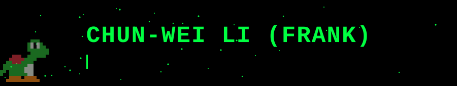

  

 

## 🎓 Education

- **National Taipei University of Technology**: M.S. in Computer Science and Information Engineering, 2026 · GPA: 4.0/4.0
- **Fu Jen Catholic University**: B.S. in Computer Science and Information Engineering, 2024 · GPA: 3.92/4.3

## 🔬 Research & Publications

### 📜 Master's Thesis: AI-Assisted Software Engineering
**[A Pattern Language Prompt-Based Approach to AI Code Generation for Software Architecture: A Case Study of DCI Architecture](https://hdl.handle.net/11296/rwta59)**

- Investigated Pattern Language-based prompting to constrain AI-generated code to DCI architectural styles built upon DDD, Clean Architecture, and CQRS.
- Developed AI-assisted code generation and refactoring mechanisms with JavaParser-based AST verification.

### 📄 [TCSE 2024 Publication: First Author](https://github.com/chun-wei0413/crms-edge-home) · Mar 2024 - Jul 2024
- Explored the feasibility of using idle household IoT devices as edge-computing resources.

## 🚀 Side Projects

### 🔎 [WTM: Meme Semantic Retrieval System](https://github.com/chun-wei0413/WTM) · Oct 2026 - Present
**Java / Spring Boot / React / TypeScript / PostgreSQL / Ollama / RAG / Kubernetes**

- Combined vector search and BM25 keyword search with weighted ranking for natural-language meme retrieval.
- Integrated vision-language models and LLM-based explanations; containerized the system with Docker and automated CI and image publishing using GitHub Actions.

## 💼 Project Experience

### 📋 ezKanban: Microservices-Based Collaboration System · Jul 2024 - Aug 2026
**Java / Spring Boot / DDD / Clean Architecture / CQRS / Event Sourcing / Kafka**

- Developed a real-time collaborative kanban system to digitize and optimize agile project management workflows.
- Practiced modern software paradigms (combining microservices, event-driven architecture, TDD, and Mob Programming) to ensure high software quality and maintainability.

## 🛠️ Technical Skills

| | |
|:--|:--|
| **Programming Languages** | Java, C++, Python, JavaScript, TypeScript |
| **Backend & Frontend Development** | Spring Boot, React |
| **Software Architecture & Patterns** | Domain-Driven Design (DDD), Clean Architecture, CQRS, Event Sourcing |
| **Software Design & Practices** | Design Patterns (GoF), Test-Driven Development (TDD), Mob Programming |
| **Data & Messaging** | PostgreSQL, Kafka, EventStore, RustFS |
| **AI & LLM** | Large Language Models (Ollama), Retrieval-Augmented Generation (RAG), Model Context Protocol (MCP) |
| **AI Tooling & Agents** | OpenAI Codex, Claude Code |
| **DevOps & Observability** | Docker, Kubernetes, GitHub Actions, Nginx, Prometheus, Grafana |
| **Software Testing & Automation** | JUnit, Robot Framework, Appium |

## 🏅 Additional

- **Certifications:** Andes Certified Engineer (ACE), Advanced Level, RISC-V; iPAS Information Security Engineer, Associate Level
- **Languages:** Mandarin (Native), English (TOEIC L&R 830)

## 📊 GitHub Activity

  
  
   
  
   
  

  

## 📬 Contact

